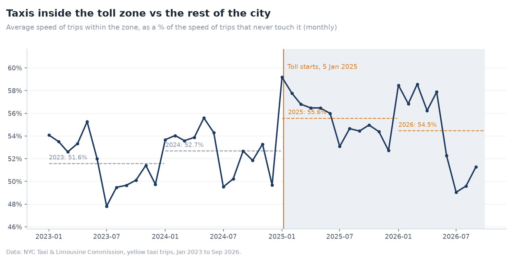
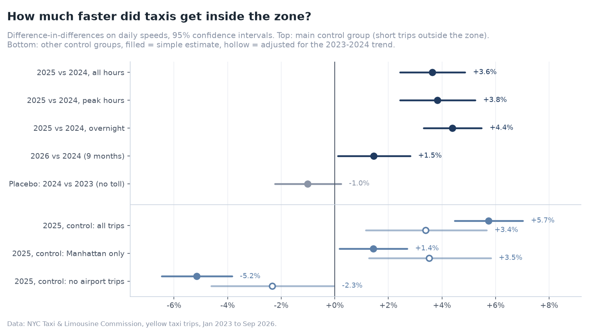
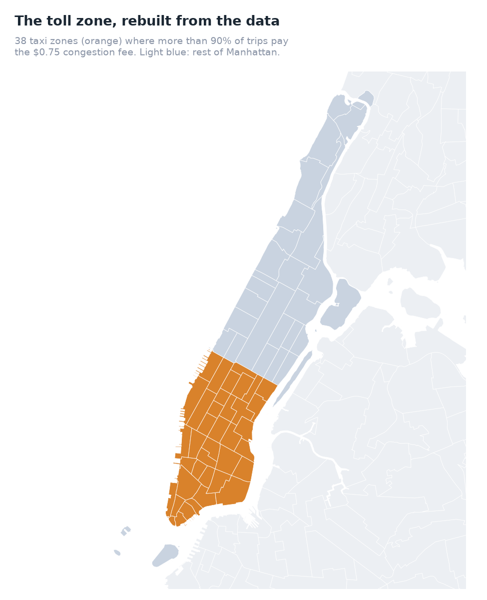
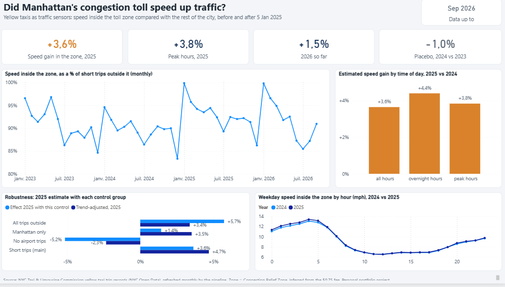
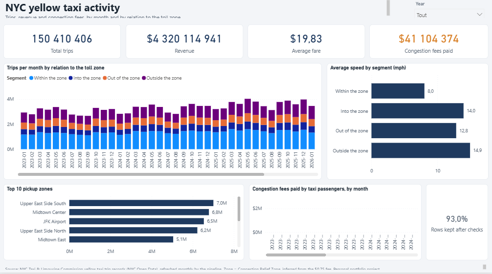

# Did Manhattan's congestion toll speed up traffic? Using NYC taxis as traffic sensors

On 5 January 2025, New York became the first US city to charge drivers for entering its centre
(Manhattan south of 60th Street, $9 for most cars at peak time). The promise: fewer cars, faster streets.

Yellow taxis only pay $0.75 per trip, so they kept driving through the zone. That makes them a free,
city-wide network of traffic sensors. If traffic really got lighter, taxis inside the zone should have
become faster **compared with similar taxi trips elsewhere in the city**. This project measures exactly that,
on every yellow taxi trip since January 2023, with a pipeline that refreshes itself every month.



## What I found

- **161.8 million trips** processed (January 2023 to September 2026); 93% kept after the quality checks.
- **I rebuilt the toll zone from the data.** The city does not publish which taxi zones are inside it, but since
  January 2025 every trip that starts or ends there pays a $0.75 fee. 38 zones stand out, all of them in Manhattan:
  more than 92% of their trips pay the fee, against 62% at most for any other busy zone.
- **Main result: taxis inside the zone got about 3.6% faster in 2025** than comparable short trips elsewhere in the city
  (95% confidence interval: +2.4% to +4.9%). The same test run on 2024 vs 2023, when there was no toll, gives −1.0%
  (not significant), which is what you want from a placebo.
- **The effect is modest and fading.** It drops to +1.5% for the first nine months of 2026. In plain speed, taxis inside
  the zone went from 7.9 mph in 2024 to 8.1 mph in 2025, then back to 7.8 mph in 2026 so far.
- **My first estimate was wrong, and the robustness checks caught it.** Against *all* trips outside the zone, the effect
  looked like +5.7%. But that control group mixes airport runs and highway trips with local streets, and those moved in
  different directions in 2025: trips from JFK got slower (21.6 to 21.0 mph) while longer trips outside the zone got faster,
  which is consistent with the toll also easing traffic on the roads leading to Manhattan. Short local trips are the
  fairest comparison, and they are also the only control group that passes the placebo test.
- **Taxi passengers paid $41.1 million in congestion fees** between January 2025 and September 2026.

This lines up with the official picture: the MTA's one-year report describes faster traffic in the zone and much faster
bridges and tunnels, and several observers noted that the gains inside the zone shrank after the first months.



<p align="center"></p>

## Power BI dashboard

Two pages, built as a Power BI project (`powerbi/`) that reads the CSV exports straight from this repository,
so a refresh always shows the latest month.




## How it works

```
NYC TLC monthly Parquet files ──> Python ingestion ──> DuckDB ──> dbt (clean, model, test) ──> CSV exports ──> Power BI
                                      └────────────── GitHub Actions, every month ──────────────┘
```

| Step | Folder | What it does |
|---|---|---|
| Ingestion | `ingestion/` | Downloads the monthly files, skips what is already there, never leaves a half-written file, reports months not published yet. |
| Transformation | `transform/` | dbt + DuckDB. DuckDB reads the Parquet files in place (no copy), dbt cleans the trips, infers the toll zone, tags every trip, builds the marts and runs 18 data tests. |
| Export | `scripts/export_marts.py` | Writes the marts as CSV (about 130k rows for the main fact table instead of 160M trips) and the headline numbers to `exports/summary.json`. |
| Charts | `scripts/make_charts.py` | Redraws the charts above from the exports. |
| Automation | `.github/workflows/pipeline.yml` | Smoke test on synthetic data at every push; full refresh on the real data on the 20th of each month, which commits the new exports and charts. |
| Dashboard | `powerbi/` | Power BI project generated from code (`build_report.py`): model, DAX measures, two pages. |

The whole refresh (download, 160M rows, models, tests, exports) runs in a few minutes on a free GitHub runner.

### dbt models

- `staging`: one view per source, clean names and types, nothing removed.
- `intermediate`: quality rules (`int_trips_checked` keeps the reason each bad row is rejected), the inferred toll zone
  (`int_crz_zones`), each trip's relation to the zone (`within`, `into`, `out of`, `outside`) and the daily speed per group.
- `marts`: the fact table for Power BI (day × hour × segment), dimensions, the difference-in-differences results,
  the monthly event study, speeds by hour and the data quality report.

Quality rules: a trip is dropped if its pickup date is outside its file's month, its zone is unknown, its duration is not
between 1 and 180 minutes, its distance is not between 0.1 and 60 miles, an amount is negative, or its speed is not between
1 and 80 mph. Tests check among other things that every inferred toll zone is in Manhattan and that no month loses more than 20% of its rows.

## Method

1. **Which trips are "inside"?** A taxi zone belongs to the toll zone if, after 5 January 2025, at least 90% of the trips
   starting there *and* 90% of the trips ending there paid the congestion fee.
2. **Daily speed gap.** For every day, `gap = ln(speed of trips within the zone / speed of the control group)`, with
   speed = total distance / total time.
3. **Difference-in-differences.** Effect = average gap in 2025 − average gap in 2024, on the same calendar months.
   Anything that hits the whole city on a given day (weather, holidays, a general traffic trend) cancels out in the gap.
4. **Placebo.** The same calculation for 2024 vs 2023 should be close to zero, since there was no toll in either year.
5. **Robustness.** The estimate is repeated with four control groups (all trips outside the zone, no airport trips,
   Manhattan only, trips under 3 miles), with and without a correction for the trend already visible between 2023 and 2024.
   The main control is short trips (< 3 miles) outside the zone: they look like the trips inside it and they pass the placebo test.

### Limitations

- Taxis are a sample of traffic, not all of it, and their speed includes time stuck at lights and picking up passengers.
- If the toll also sped up traffic outside the zone (the MTA reports faster bridges and approach roads), part of the effect
  is absorbed by the control group, so the estimate is a lower bound of the change inside the zone.
- The confidence intervals treat days as independent, which makes them a bit too narrow.
- The yellow taxi market itself changed (more trips in 2025, different mix of destinations), which can shift average speeds.

What I would do next: a regression with zone and hour fixed effects, adding Uber/Lyft trips (much larger volume), and weather data.

## Run it

```bash
python -m venv .venv
.venv\Scripts\activate          # Windows  (source .venv/bin/activate on Mac/Linux)
pip install -r requirements.txt
python scripts/run_pipeline.py --sample   # synthetic data with a known effect, about a minute
python scripts/run_pipeline.py            # real data, ~3 GB download
```

The synthetic data contains a known effect (+10% at peak hours, +4% overnight inside the zone after the toll),
which the pipeline recovers, while its placebo stays at zero. It is how I checked the method before running it on real data.

To open the dashboard: `python powerbi/build_report.py`, then open `powerbi/NYC_Congestion.pbip` in Power BI Desktop
and click Refresh (choose anonymous access if asked).

## Data and licence

Trip records: [NYC Taxi & Limousine Commission](https://www.nyc.gov/site/tlc/about/tlc-trip-record-data.page),
published as NYC Open Data, which can be used without restriction. Context on the toll's first year:
[MTA one-year report coverage](https://www.6sqft.com/one-year-of-congestion-pricing-in-nyc-27-million-fewer-vehicles-less-traffic).
This is a personal portfolio project, not affiliated with the TLC or the MTA.
